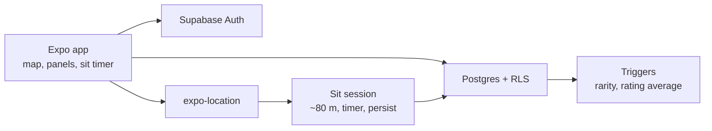

# ŁawAppka (Benchy)

A map-first mobile app for finding, adding, and rating public benches, with location-aware gameplay that only counts when you are actually sitting on one.

Built by **Me** as a full product: React Native client, Supabase backend, and the rules that keep those two honest with each other.

[](https://reactnative.dev/)
[](https://expo.dev/)
[](https://www.typescriptlang.org/)
[](https://supabase.com/)

## Why this exists

Cities are full of places to sit, and almost none of them are easy to find on purpose. ŁawAppka treats a bench like a place worth returning to: you pin it, describe it, rate it, and, if you are close enough, sit on it. The sit is the point. Time in the app does not count. Time on the bench does.

The interesting part of the project is not the map pin. It is keeping a playful product strict: GPS has to match the claim, progress has to survive a restart, and the database has to refuse writes the client should never be trusted to police.

## What the product does

A signed-in user can:

- browse benches on a map, coloured by rarity, and filter to favourites
- add a bench from GPS or by dropping a marker on the map
- pick a bench type from local 2D icons (wooden, metal, stone, designer, or “other”)
- rate and comment, save favourites, and open a list or “nearby” panel sorted by real distance
- start a sit session on Bench Details when they are within about 80 m, with a live timer and a 3D character
- collect achievements, titles, and a login streak from actions that happened, not from opening the app

The interface is Polish and English. Registration can fill a random nickname; in Polish the adjective agrees with the noun (`Bystra Sowa`, not `Bystry Sowa`).

## Engineering decisions worth reading

**The server owns the rules.** New benches get a rarity tier from a Postgres trigger (`set_smart_rarity`), not from whatever the phone sends. Rating averages, achievements, and profile totals follow the same idea: the client displays state, the database decides it.

**Access is row-level, not “the anon key is secret”.** User-owned rows (ratings, favourites, sit sessions, profiles) are scoped to `auth.uid()`. Dictionary tables stay readable. The `bench_details` view runs as the caller (`security_invoker`), so it cannot bypass those policies.

**A sit is a location claim.** The timer starts only near the bench, sessions under two minutes do not count, and achievements such as a 30- or 120-minute sit read `total_sit_minutes`. Leaving the app open is not progress.

**The map is the home screen.** Lists, profile, add-bench, and nearby results are slide-in panels around that map, not a tab bar fighting the map for space.

**Assets stay on the device when they should.** Bench-type icons are a local name → PNG map. The database keeps a short type name and an emoji fallback. The map marker stays one icon plus a rarity colour, so a busy map does not download a different image per pin.

**One theme, two languages.** Colour comes from a single `appTheme`. Language follows the system or an explicit PL/EN choice stored on the device.

## How it fits together



1. The app signs in with email and password and talks to Supabase with the public anon key.
2. Reads and writes go through RLS. A stolen anon key still cannot edit someone else’s bench.
3. Inserting a bench runs `calculate_smart_rarity()` and stores `rarity_id` before the row is visible as “chosen by the user”.
4. Sitting writes a `sit_sessions` row and rolls the minutes into the profile. Achievement checks read those totals.

Rarity, in short: the function looks at how many benches already exist in each tier and promotes the new one when rarer tiers are under-represented (thresholds use `ceil(1.2 × …)` and `ceil(1.5 × …)`). An empty database starts at **normal**. A bench can still be adjusted later from its details screen, within what RLS allows.

## Stack

| Layer | Choice |
| --- | --- |
| Client | React Native, Expo SDK 54, TypeScript |
| Navigation | React Navigation, plus a custom panel navigator on the map |
| Maps and place | `react-native-maps`, `expo-location`, reverse geocoding |
| Sit scene | `expo-gl` and Three.js, local `sit-character.glb` |
| Copy | `i18next` (`en.json`, `pl.json`) |
| Backend | Supabase: Auth, Postgres, Storage for avatars |
| Safety | RLS, triggers, `security_invoker` views |

Repository map: `benchy-fe/` is the app (`src/screens`, `src/components`, `src/contexts`, `src/lib`, `src/theme`). `benchy-be/supabase/migrations/` is the schema. `database.sql` is the full install; the other SQL files are incremental updates for a database that already exists.

## Run it

```bash
git clone <repo-url>
cd Benchy/benchy-fe
npm install
```

Point the app at a Supabase project in `app.json` → `expo.extra`:

```json
{
  "expo": {
    "extra": {
      "SUPABASE_URL": "https://YOUR_PROJECT.supabase.co",
      "SUPABASE_ANON_KEY": "YOUR_ANON_KEY"
    }
  }
}
```

Apply `benchy-be/supabase/migrations/database.sql` on a new project (SQL editor or the Supabase CLI). On an existing project, apply only the incremental files you have not run yet: login streak, avatars, sit sessions, park bench type, sit-minute achievements, and the `bench_details` security-invoker fix.

```bash
npx expo start
```

Expo Go is enough to click through most screens. Maps and the sit flow are most reliable in a dev build (`npx expo run:android` / `run:ios`) or an EAS build. Typecheck from `benchy-fe/` with `npm run build` (`tsc --noEmit`).

The anon key belongs in the client. The service role key does not. Do not commit it.

## Production builds

```bash
npm install -g eas-cli
eas login
eas build --platform android
eas build --platform ios
```

Signing, map provider keys, and store listings live outside this repo.

## Credits

Map marker: bench icon by [Freepik](https://www.flaticon.com/authors/freepik) via [Flaticon](https://www.flaticon.com/free-icons/bench). See [benchy-fe/ATTRIBUTIONS.md](benchy-fe/ATTRIBUTIONS.md).

MIT. See [LICENSE](LICENSE).
